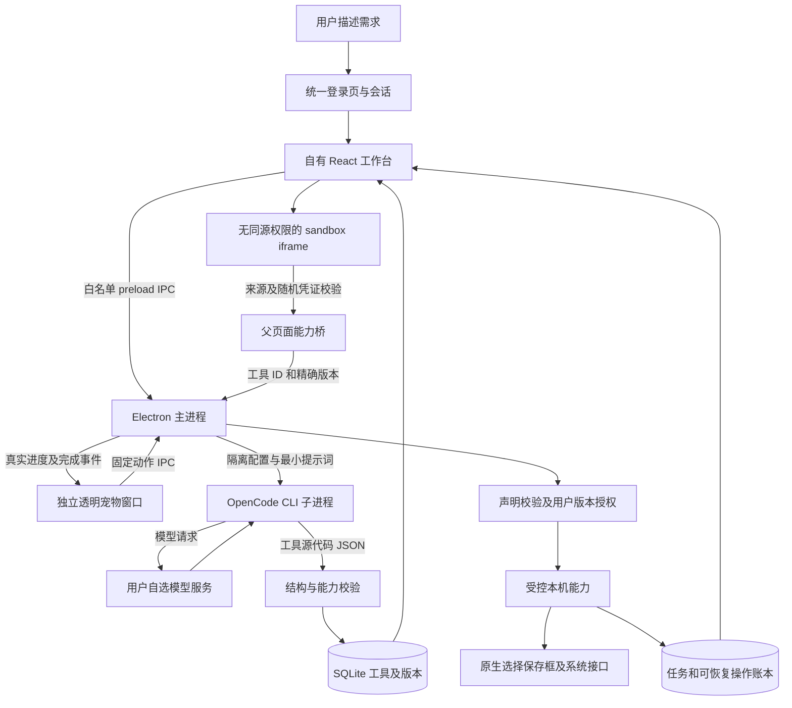

# Momo 桌面架构 v3 · macOS 工作教练

这是当前代码实现边界。OpenCode 负责理解和生成，Electron 主进程负责授权与真实动作，SQLite 负责持久事实。宠物通过原参考视频透明VP9原速播放呈现动作、真实建议与待办提醒；观察和优化由宿主确定性服务管理。

## 责任与权威

| 模块 | 权威及契约 |
|---|---|
| 统一身份 | 应用内固定邮箱与scrypt哈希，不读写本机账户文件；失败冷却及会话只在主进程内存。未认证时工具/设置/文件IPC拒绝，退出使界面卸载并隐藏桌边宠物 |
| 主界面 | 用户输入、临时预览、参数；桌面工具目录以 SQLite 回读为准 |
| OpenCodeEngine | request / previous bundle → 验证后的 7 字段 bundle；全部内置 Agent 工具拒绝，不执行生成源代码 |
| 工具包 | title、description、html、css、js、permissions、inputHint；版本不可变，恢复产生新版本 |
| 主进程 | 窗口可信来源、当前版本、用户授予的能力；模型不参与授权决定 |
| 运行页面 | `sandbox=allow-scripts`，没有 allow-same-origin；CSP 禁网络、外链、子框架、表单和 eval |
| 本机代理 | 选择产生不透明句柄；读取验证选择、类型、大小、未变化状态和非符号链接；输出只新建，不覆盖 |
| SQLite | 工具、版本、设置、任务、改名账本唯一事实源；重启将运行任务标为中断，补充遗留恢复入口 |
| 宠物 | 独立透明窗口、连续Three.js分部关节动作、短绒毛、点击穿透；主进程控制移动/收起展开，建议/待办只调用具名IPC |
| 陪伴服务 | settings.companion保存事实/推断、待办、观察授权、计数、建议与提醒账本；不持久化被观察文件名/内容 |
| macOS观察 | Swift helper只读前台应用名/bundle ID；fs.watch单层指定目录只统计事件；默认关闭、排除和暂停可控 |
| 优化服务 | settings.optimizer保存有限候选、学习计数和上一版关系；工具代码仍以SQLite不可变versions为准 |

## 登录与窗口

使用固定统一邮箱和密码→scrypt哈希校验→主进程建立内存会话并放行IPC。没有注册入口，不读写旧账户文件；重开应用需要重新登录。退出时有运行中任务会要求先取消或等待，成功退出后清空临时能力句柄、卸载工作台并隐藏宠物。当前为应用内统一凭据校验，不提供云身份、多租户或工具文件加密。

Electron titleBarStyle hidden保留macOS原生窗口控制；侧栏顶部和主工具栏提供drag区域，按钮no-drag。共享AnimatedPet使用延迟加载的Three.js场景：连续呼吸、眨眼、关节步态、转头和短绒毛；隐藏时暂停、减少动态时静止。WebGL失败与自定义单图回退静态图。窗口运动与步态使用同一motion事件。应用内收起/双击展开使用320ms内容过渡和原生窗口生命周期，原生最小化仍由macOS处理。

## 两条执行链

制作链：需求 → generate IPC → 创建 running 任务 → OpenCode 在独立 HOME/XDG/配置目录运行 → 自选模型返回 JSON → validateBundle → 检查取消与版本冲突 → SQLite 生成 draft 版本 → 主界面试用。取消、超时、错误均留真实任务状态；迟到结果不能覆盖新版本。

使用链：当前保存版本 → iframe → postMessage → 父页面校验 frame 来源、token 和请求 ID → runtimeInvoke → 主进程校验工具精确版本、能力声明和版本授权 → 系统选择框/能力代理 → 回执/账本 → iframe 显示结果。旧页面不能继承新版本授权。

文件改名走可信内置工具：主动选文件 → 生成完整计划 → 检查冲突 → 原生确认 → 写入操作账本 → 不覆盖操作与失败补偿 → 完成回执。恢复以账本和文件当前状态判定，不能只凭前端任务状态。

## 本机能力范围

V1 自定义工具提供选择/读取文本、保存文本、读写剪贴板、通知、用默认应用打开当前工具生成的输出。权限独立声明和授权。文本输出限制安全扩展名，禁止导出脚本后直接执行。文件读取上限 8 MB；内置 CSV 上限 4 MB。

不包含任意 Shell、npm/pip 安装、全磁盘扫描、任意应用控制、任意后台脚本调度、OCR、XLSX/PDF 原生解析、独立工具 EXE 导出或应用市场。工具目前依赖 Momo 宿主运行。这些是后续能力扩展范围，不以“单机”暗示已经覆盖整个操作系统。

## 复用与选择

复用 React 视觉、CSV 确定性算法、Electron 官方进程/窗口/对话框/凭据加密、OpenCode 官方 CLI。没有复制 Code OSS 的编辑器、调试器和扩展宿主。本产品首先交付可用小工具，无需承担完整开发者 IDE 的维护面。

V1 使用 CLI 适配而不是另起 OpenCode 常驻服务器：易于隔离任务配置、终止进程和打包；通过 OpenCodeEngine 契约保留以后替换 Server/SDK 的边界。模型仅返回代码，可靠的内置工具和日常运行不需要持续调用模型。

## 验收与剩余风险

静态校验不能证明生成工具的业务正确性；用户需用代表性数据试运行。iframe/CSP/主进程版本授权构成执行边界，静态关键词过滤仅为附加门。当前发行没有签名、公证和自动更新。UI 验收及自动测试记录见 evidence/desktop-verification.md。

窗口实现依据：[Electron Custom Title Bar](https://www.electronjs.org/docs/latest/tutorial/custom-title-bar) 与 [Custom Window Interactions](https://www.electronjs.org/docs/latest/tutorial/custom-window-interactions)。本轮验收增量见 evidence/native-login-verification.md；本机登录与动态图集输入契约见 docs/native-login-pet-task.md 和 docs/pet-assets.md。

## 工作教练处理链（0.4）

登录→companion.start/petController.start；登出/锁屏/休眠停止观察与调度，恢复后仅已登录会话重启。观察默认关闭；用户分别授权inApp、单层目录和前台应用。暂停观察保留明确约定的待办和休息提醒。Swift helper附带abort与2.5秒超时，不读取窗口标题、屏幕、按键、剪贴板。

观察→有限计数→冷却规则→建议→用户接受打开工具或填入需求；不直接执行文件操作。用户确认的fact记忆仅在独立开关开启后，最多5条/2000字随生成或优化请求发送自选模型；原始观察记录不发送。

成功使用→主进程检查观察开启且未暂停→校验完整参数与唯一usageId→三次同参数→仅报价输入/命名前缀可自动新增版本；匹配字段与自定义源码需候选、差异、受限试用和人工确认。启用前复查版本、观察授权和登录，STALE_TOOL不覆盖。每次优化保留立即前版，一键回退产生新的不可变版本，原历史仍在；清除临时文件/输出句柄，权限按新版本重新授权。

待办中文明确时间按Asia/Shanghai解析，含糊/已过去的描述要求具体时间；提醒先记账后提交OS和宠物，防止重启重复。系统通知无法保证视觉送达，失败或漏送可稍后重新安排。休息按真实idle信号累计，锁屏/休眠/时钟跳跃不加时；关闭应用期间不通知。

入口src/CompanionPanel.jsx，后端electron/companion.cjs与optimizer.cjs，窗口electron/pet-controller.cjs，原生electron/observer-macos.swift。任务及回退见docs/companion-v1-task.md，证据见evidence/companion-v1-verification.md。

## 0.5 修复边界
默认 AnimatedPet → PhotoPetScene：原atlas固定第0帧，预计算空间权重，时间连续变形，不切图。pet-controller负责fold/hide与prepare-unfold/renderer ACK/unfold；窗口导航统一经过该控制器。saveTool按业务内容幂等，expectedVersion防止旧界面覆盖新版本；自动优化结果同步编辑器版本和保存状态。

## 0.6 原视频动作边界
权威媒体：output/rabbit-animation/rabbit-actions-15s.mp4→本机Vision前景分割→public/assets/momo-actions.webm与poster。AnimatedPet→video-pet-playback使用原生媒体时钟、1x播放、全部362帧24fps，隐藏/离屏/静止时暂停，恢复不重置时间；失败明确重试且不使用旧动作假兜底。pet-controller默认referenceVideo模式不自主位移/反向；拖动、clamp、菜单和fold/unfold状态机沿用原实现。没有新IPC、权限、网络或schema。

## 0.7 循环连接资产
默认AnimatedPet视频引用改为momo-actions-loop.webm（404帧24fps）。原362帧完整前缀不动，离线追加42帧解剖配准/预乘纹理/SDF轮廓连接；运行时不合成、不增加第二媒体控制器。原生video循环、visibility/quiet/retry、双击恢复协议不变。原媒体momo-actions.webm可直接切回。
