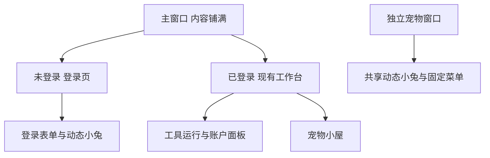
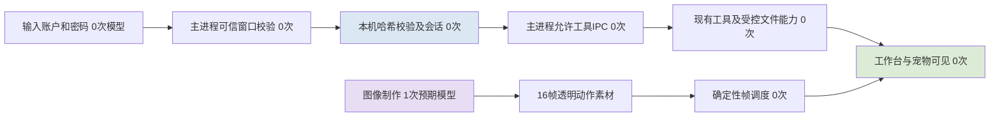

# 无标题栏、登录与动态宠物

任务 MOMO-002；用户目标：去掉传统上边框，采用macOS整合式窗口；同风格登录；宠物自然活动、质感真实。主Agent负责窗口/鉴权接线/最终包；china_market负责本机账户核心与测试；runtime_ui负责登录/账户界面；table_engine负责共享动态宠物及独立窗口。所有工作限本机，不发布。

## 当前与目标

当前：标准Electron标题栏→直接进入工作台→静态兔子图片整张浮动。权威源为electron/main.cjs窗口配置、src/main.jsx入口、src/pet.jsx/pet.css及素材。桌面工具和文件代理不应因改外观改变。

目标：系统红黄绿按钮融入内容区，顶部可以拖动且不遮挡交互；未登录先显示统一奶油/鼠尾草绿登录页，本机注册→登录→工作台→账户退出；主进程同步拒绝未登录工具/设置/文件IPC。动态宠物采用真实毛发小兔的逐帧眨眼和耳部/头部细微动作，不将整图漂浮当作真实动作。

页面图展示登录与工作台的切换，以及共享宠物的消费者；处理链展示身份在主进程拥有权威，图像只作为素材输入，运行期动画不需模型调用。所有图中节点是本轮目标，验收记录另列。

## 产品与技术审视

产品：同视觉风格，登录只有一个主操作；没有账户服务时不显示假的短信/微信/Apple登录。已向用户异步确认本机/云端选择，先进行不依赖答案的窗口与动画工作；若无回复按可实际运行本机账户推进。登录不承诺文件加密或云同步。现有工具数据保持同一单用户个人空间。

技术：复用Electron隐藏标题栏和原生窗口控制、现有preload/可信IPC/SQLite；不新增云端控制面。密码由crypto.scrypt加盐哈希，账户独立0600原子落盘，默认重启需登录；注册不覆盖既有账户，损坏数据失败关闭。主进程会话为权限源；退出清空运行页面与临时能力句柄；有未完成任务时要求先取消或等待，避免丢失本机操作回执。模型不参与登录。

动画：复用现有透明宠物窗口/菜单/偏好；新共享组件使用本地透明图集，减弱动态时静止，不可见时暂停；用户导入单张图片保留静态，不冒充真实动作生成。

验收：注册/错误密码/登录/退出/重开；未登录IPC拒绝；标题栏无传统横条，红黄绿/拖动/关闭/最小化/缩放可用；登录、首页、宠物页和独立窗口自然动作可见；现有报价、文件授权与版本功能回归。打包后在实际macOS窗口验证。

回滚：evidence/before-native-login-20261021.tar.gz恢复本轮前源码；旧0.1.0开发包另存。退出后保留用户数据目录，本轮账户仅新增独立文件，不删改工具数据库或用户文件。

## 交叉复核增量

实际窗口关闭测试发现：宠物重新建主窗口时，导航事件早于React订阅，目标丢失到首页。已由主进程保留一个待执行固定动作，React订阅后uiReady回执才投递；退出清待执行动作，最小化先恢复窗口。新增主进程回归覆盖窗口重建、只投递一次及已有窗口直接导航。

登录复核：已登录时重复登录直接返回当前会话，不调用会清会话的密码校验；并发登录/注册单飞；错误同步匿名状态。退出在无inflight时重建能力代理实例，使旧文件句柄和改名计划不可复用，持久改名恢复账本不受影响。新增重复认证/并发认证与临时授权会话隔离测试。

## 当前交付状态

实现、62项测试和macOS arm64 0.2.0开发包完成，当前源码与包内已核对。实际UI已验证注册空态、错误/正确登录、退出、重开、自然兔子帧和原生关闭窗口。最新导航修复后的最终GUI复验因Mac锁屏待用户解锁，具体证据与限制见 evidence/native-login-verification.md。已停止独立验收profile进程，改为启动正常个人空间供用户自行创建账户；正常空间未预置验收账户。未绕过锁屏。

## 解锁后补验完成

用户确认先做本机账户并解锁Mac。最终0.2.0原生应用实际登录、原生关闭主窗口、宠物准确打开最近报价工具、最小化恢复、账户退出返回登录页均通过；本次仅补验证与证据记录，没有应用代码变化，无需重新打包。锁屏阻塞解除，详见evidence/native-login-verification.md。
