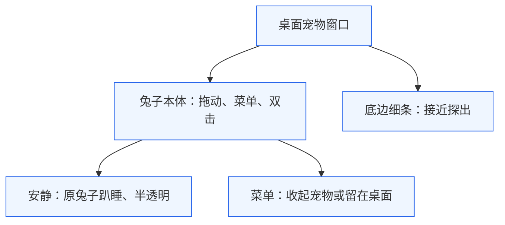
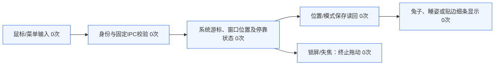

# MOMO019：桌面宠物拖动、睡眠与贴边

目标：在架构v3、修订907d4cd上复用独立透明窗口及主进程控制器，实现兔子本体四向拖动、安静睡眠半透明、菜单收起至底边细条，靠近探出、离开退回。版本0.7.11。账户、观察权限、工具、优化和原495帧动作视频不改。主Agent负责窗口/手势；独立Agent负责睡姿与状态测试/审查，无递归委派。

兔子本体承担鼠标手势；菜单控制停靠与安静；细条始终留在当前显示器可用区域底边，避免覆盖Dock。睡眠不换角色，仅采用原参考视频清晰闭眼帧。

S1接收手势，S2沿已有白名单与登录边界进入主进程；S3接收当前宠物的捕获手势坐标，在主进程验证有限值并约束到显示器身体安全区；拖动结束也立即采样，不依赖定时器赶上快速手势。悬停以系统游标为主，窗口内转发鼠标点仅作180ms提示，离开/失焦/停靠重定位/停止时清除。S4仅在拖动结束/停靠切换时保存pet设置，S5消费状态完成显示。S6清理手势，防止恢复后沿旧游标移动。全链无模型调用，观察服务不参与。

| 边界 | 修改/保护 |
|---|---|
| electron/pet-controller.cjs | drag/dock主状态、游标接近轮询、四向身体边界、位置保存回调；保留工作台fold/unfold |
| electron/main.cjs、preload.cjs | 两个固定白名单方法，沿用登录/顶层窗口校验、settings持久化 |
| src/pet.jsx、pet.css | 5px拖动阈值、拖动后抑制单/双击、失焦清理、320ms滑入、300ms离开延时、48%睡眠透明度 |
| AnimatedPet.jsx、animated-pet.css | sleeping姿态覆盖并暂停原视频；解除后继续原媒体时间，不重置 |
| public/assets/momo-sleep.png | 原frame0089字节复制，RGBA832×768，不滤波、不变形 |
| 原动作WebM与SQLite工具 | 保留原SHA与三个工具内容，默认visible=true；docked独立于visible及工作台folded |

验收：单击菜单/双击工作台与拖动互不误触；四向及跨屏边界；菜单可操作；quiet闭眼半透明；dock只剩细条，接近探出/离开退回；重启保存位置/停靠；失焦/锁屏/退出安全终止。原生验证与自动测试分别记录，不以构建通过代替桌面验收。

回退：保留0.7.10 ZIP及clear/refined原素材；撤回本轮代码和新睡姿即可，旧版忽略pet.position/docked字段，无需覆盖SQLite或账户数据。

## 本机验收与修复回读

193项测试通过、1项真实凭据测试跳过；独立29项停靠/拖动测试包括四向、无轮询快速释放、非法坐标、负坐标屏、位置重建、hint过期、真实游标接管及锁屏清理。

实际canonical包0.7.11的main/controller/preload与源码SHA逐一相同；原495帧WebM SHA仍888ab281f4b1de32923f404f0b03e9eb8884ffdabed6d445a597659875baf030，睡姿SHA与原0089帧一致。截图位于本机evidence/momo019：quiet-final.png（闭眼半透明）、hidden-final.png（仅细条）、peek-final.png（短时探出且菜单可见）、peek-body-final.png（退回细条）、awake-final.png（恢复原动作）。目标窗口为真实app.asar/dist/pet.html。

实测发现初稿仅依靠33ms系统游标轮询可能漏过快速目标鼠标事件，位置未保存；修复为捕获手势坐标+end即时采样，补无轮询回归。修正版读回位置从左上1195,389到右下1219,413；最终包再次拖至1150,344，松手无误菜单，双击可重建并展开工作台。quiet开启后不影响菜单操作，关闭后恢复正常原视频。重启保留停靠状态，最后恢复visible=true、docked=false、quiet=false供日常使用。

探出后命中缓存也已修正：docked/peek改变时重新计算指针下的按钮，避免沿用隐藏时的穿透状态。自动化目标鼠标事件与系统全局游标可能不一致，因此真实窗口证据只证明短时探出和退回，不冒充物理鼠标长时间停留或每帧动画零丢帧；持续悬停与300ms退回由独立状态测试验证。多显示器负坐标由模拟测试覆盖，本机未做外接屏人工拖动验收。

旧0.7.10压缩包保留。回滚代码可撤回本轮提交并使用旧包，删除pet.position/docked不是必需操作；不覆盖用户工具或账户。

### macOS顶部原生约束

额外原生验收发现macOS把高透明窗口的y限制在菜单栏下方，保留500px空白会使兔子到不了顶部；mock屏幕坐标未体现此OS约束。修复在靠近顶部时仅缩短预留的透明空白（窗口最小194px），固定185px兔子盒不缩放，保存位置统一换算到500px逻辑坐标。向下拖动、打开菜单或停靠恢复500px窗口，解除停靠及重启按同一身体坐标重建。此为窗口几何修正，不修改原动作素材或兔子形状。

最终原生复验：top-native.png为520×610，即窗口从500缩至305DIP，兔子盒仍固定185DIP；top-menu-native.png恢复520×1000，菜单完整。补改后再次确认睡眠、停靠细条、探出、退回及唤醒；最小194DIP布局和垂直多屏恢复由独立测试覆盖，未冒充全部硬件边界实测。
