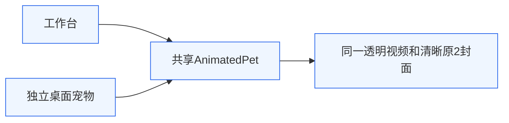
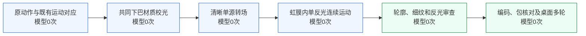

# 0.7.10 接点反光与下巴照明

## 范围和处理链

沿用架构v3、独立桌面pet.html、共享AnimatedPet、495帧24fps及原alpha轨迹，只修素材。账户、权限、观察、工具数据和窗口/播放器生命周期不改。原0.7.9与clear资产保留回退。

两处界面消费同一资产，本轮最终以独立桌面窗口多轮实播验收。

S1复用原动作，S2只在共同下巴白毛材质内校正底色，S3保持单源清晰细节。S4仅处理虹膜内部反光小岛，眼形不动；S5审查保护边界与清晰度，再由S6装入实际应用验证。这里的0次指产品素材处理过程，不含开发分析。

## 新定位与拒绝项

0.7.9去掉叠图糊化后，出口仍有真实局部差异：亮点阈值Y>.4从3像素/峰.430变为15像素/峰.552，质心位移约2.45px；源眼睁开程度也不同。入口亮点相对iris质心仅约.17px位移，因此不搬入口高光。

共同白毛芯区排除材质覆盖变化后，出口低频变化范围约.01839，原转场的sigma4只压住首步，后续仍逐步带回光照差。额头首步微纹理RMS约.7个8bit码值，不能为了追零而模糊、强锐化或换整块脸。

已拒绝：全白毛共用平面（局部收益小且额头蓝通道更差）；未保护高亮的加法照明（少数像素新增clipping）；整iris/高光硬贴（双glint和黑边）；按须毛纹理挖洞的照明mask（斑点风险）；逐帧重认A亮点（会跳到眼缘）。大面积白毛移植候选也拒绝：静止出口细纹差可减半，但需要改约7.5万白毛像素，原111→112材质交接并未消除，只前移到睁眼。本轮保留微毛纹本身，优先用更小修正保护原形象。

## 方法

下巴拟合只用严格共同白毛芯区，排除须毛作拟合；应用使用完整宽缓材质包络，给须毛与周围加相同RGB底色，保留局部对比。眼、运输鼻嘴保护、围巾与alpha锁定。没有输出图像滤波、纹理平均或细节增益。

反光从已经校过光的实际桥画面提取，避免扣原B亮点后留下黑洞。9px形态opening只估反光岛下面的暗底，不作用于整眼或毛纹输出。同一个真实反光小岛在虹膜内平移不到3px、强度跟随端点测量，不缩放眼形、不复制整眼；原A亮点锚随既有flow运输，防止检测跳到亮眼缘。强度因子不超过1.05、不得新增clipping，域外RGB及alpha精确保留。入口不改。

## 验证与限制

独立候选审查：高光首亮点由旧15像素/峰.552/质心(402.60,343.40)，变为5像素/.434/(404.40,342.20)；原A为3/.430/(404.33,341.67)。首步位置误差2.45px→约.54px，12帧均仅一个>=2px反射岛，无双glint/黑洞/眼环。108–133个变化像素全部在独立iris内区、离边界>=3.16px，域外RGB/alpha/端点精确，零新增clip。

下巴独立共同芯区光照变化范围.01839→.00849，约减54%。20帧眼和实际鼻嘴保护区及alpha精确不变，源105/106未改、112锚文件精确；芯区每通道加法常量spread=0，高频RMS比1，无新增clip、色块或须毛软化。必须区分保护范围：绿色围巾主体未改，但116/124的下巴与围巾交界极窄暗阴影条有1–4码变化，不能称整条围巾RGB全部逐字节不变。

105→112仍是原转头动作中渐入小幅照明校正，112后固定；不声称全循环恒光。两个helper已由新目录重现20张chin和12张reflection，逐文件SHA一致。162项测试通过，1项真实凭据检查跳过。最终资产495帧/24fps，SHA888ab281f4b1de32923f404f0b03e9eb8884ffdabed6d445a597659875baf030。

最终源独立验证通过：361原动作帧、完整105帧动作与12自然逆序按选定源逐文件一致；仅455..494的40帧局部RGB变化，495/495 PNG alpha与0.7.9旧轨迹精确相同，首尾文件相同，边距仍[10,12,6,44]。实际WebM解码495帧、24fps、20.625秒；解码alpha相对PNG最大误差1/255、平均0.01235个8bit码值，495帧alpha>32轮廓mask精确相同。

macOS arm64包0.7.10已安装到release/mac-arm64/Momo 小作坊.app，实际包内refined资产与正式源SHA一致，独立pet.html窗口运行。打包未签名。首次采集约17秒时Mac锁屏，185张片段已隔离为pilot-locked，不作为多轮证据。

解锁后重新进行了单次不中断的实际桌面窗口采集：2099张原始截图，首末时间跨度85.9778秒，采样间隔中位40.03ms、P99为58.53ms、最长94.67ms，没有超过100ms的间隔；覆盖4段完整循环及4次原动作进入翻身的接点。保留每张截图调用前后时间，以中点时间编码，不补帧、不插值、不重复源视频、不删除中途等待。此为真实窗口的截图采样录像，不能证明屏幕每个刷新帧零丢帧。全局24fps相位拟合仅用于定位，边界附近另保留独立画面匹配和逐轮接点拼图。

独立逐轮审查接受本轮改善：四次入口、五次出口的联系图中，未见旧版明显中段软化、新双高光/黑洞、下巴闪边、耳裁切或新增形变；入口仍能辨认两源姿态、眼神和材质差异。三轮实录desktop-three-loops.mp4及固定ROI放大版各1582帧、62.842秒；完整实录desktop-full-86s.mp4为2099帧、85.979秒。全部编码帧数与实际截图数一致、PTS严格递增，最大时间戳量化误差分别0.505ms以内及0.512ms以内。三轮范围在实际四次回环前后留余量，包含完整三轮；不依赖全局拟合的精确边界。详细本机证据位于evidence/momo018/native-review.md和audit/native-final/encoded-pts-check.json，实录文件仅保留本机，未纳入Git仓库。

回读SQLite确认3个工具内容SHA仍为110cc3a785285fdf5c6d6c436d3265a14239b8a556d293c4f66521af34500c6e；桌边陪伴为开启，安静模式为关闭。即使亮点与平均照明更连续，也不声称不同来源毛丝和物理反射逐像素完全相同。

## 回滚

默认引用恢复momo-actions-clear.webm，或使用保留的0.7.9应用包；本次提交可revert，不覆盖用户SQLite、账户或权限。
