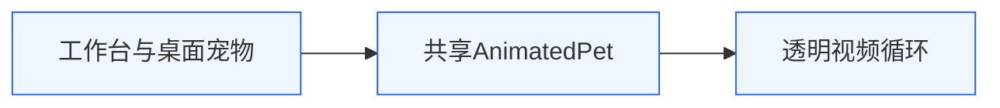
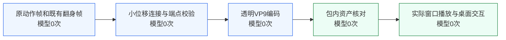

# 0.7.6 兔子循环连接

目标：保持原兔子形象和完整动作，缓和头部轮廓、毛纹及光泽在片源切换时的单帧跳变。范围仅为离线视频及默认资产引用，不改变账户、权限、用户工具和播放器状态机。架构v3责任边界不变。

## 责任链

两处界面共享同一个动画资产，所以修复落在视频，继续复用已有收起展开及播放逻辑。

素材经过离线连接、编码，再由应用直接播放；运行时不调用生成模型。原0.7.5的首个偏差在片源姿态/材质的硬接点，播放器正常循环无法消除它。上次只验证材质统计和轮廓是否明显变形，漏掉原片第1帧自身柔焦及坐稳113→112的较快转头；本次单独检查这些边界。

## 修改

默认 `momo-actions-continuous.webm`，502帧/24fps，约20.917秒。在原动作之间增加22帧：原1→原2增加4帧、原362→翻身20增加6帧、坐稳113→112增加2帧、翻身112→原1增加10帧。末帧为原1，接回首帧相同画面。原362帧与全部105帧翻身仍按原顺序完整保留；只有上述连接处延长，其他动作原速。

复用macOS Vision双向光流进行小位移对应，逆向采样后以预乘alpha和对应可信度融合，使用平滑进出速度。没有替换角色、手工TPS拉扯、大幅改姿、删除动作、额外锐化或全局模糊。新增曲线补光候选因轻微恶化入口而弃用。光流本质含局部重采样，不能宣称数学意义的零形变；目视复核五官、耳尖和身体比例，数值检查插值场未折叠，均有画面边距。

脚本：`scripts/interpolate-rabbit-seam.py`生成独立候选并审计端点/映射；`scripts/prepare-rabbit-continuous.py`只整合已接受候选。全部原始关键帧均不覆盖。候选及完整验证证据在本机 `evidence/momo014/`。

## 验证记录

- 502帧透明VP9解码后，原362帧按新位置映射逐MD5与原片一致，末帧与首帧解码MD5也一致。105翻身关键帧逐PNG哈希保留。
- 出口最大逐帧RGB差相对0.7.5降低85.3%，光泽跨度差降低81.8%，头轮廓差降低71.9%；这是图像指标，不能等同真实物理材质完全一致。
- 全部帧有边距，未再次裁切耳尖；实际插值场无折叠。放大检查未见明显双眼/双耳和身体拉伸。小位移对应仍是插值估计，不能保证每根毛发方向恒定。
- 162项测试通过，1项真实凭据检查跳过；构建及macOS arm64 ZIP完成，本机包未签名。
- 本机0.7.6包内视频SHA与正式资产相同：e7f43a0de4bc9b3da6ed26ebbfa2caa5874dd62f6ad2ae3a708acbd36793b986。
- 本机真实主窗口录制44秒，桌面宠物仍显示；现有3个工具内容SHA未变，visible=true。录制截图按原始时间编码，不能据此声称24fps零掉帧。

## 回滚

默认引用改回 `momo-actions-matched.webm`，或使用保留的0.7.5应用包。可revert本次提交；不覆盖SQLite或用户配置。小位移插值适用于本次相近姿态，不应未经复核复用于大幅转身或新角色。
