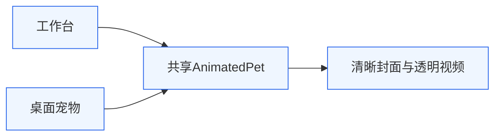
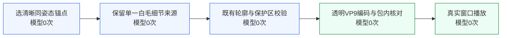

# 0.7.7 清晰纹理闭环

## 目标与定位

保留原兔子与全部实际动作，修复接回开头时的失焦→清晰，避免用整图模糊、强锐化或新增几何形变掩盖差异。职责仍为架构v3的离线素材→共享AnimatedPet→工作台/桌面宠物；账户、权限、数据库及播放器状态机不变。

两处界面共用同一资产；首帧与封面都取清晰的同姿态原2，避免加载与循环时重新引入原1失焦画面。

本次运行没有模型生成。旧版首先在S1保留了失焦首帧，又在S2平均两套不同毛纹，导致中间帧比两个端点还软。此前只看相邻帧差，未检查整段细节强度是否跌到两端以下，因而把渐进失焦误当作修复。新验收同时检查完整清晰度曲线、颜色/光泽及保护区。

## 修改与保护

默认视频 `momo-actions-crisp.webm`，497帧/24fps，约20.708秒。以清晰原2为首尾，移除失焦原1及其4张旧补间。原2..362的361张原画、翻身20..124的105张原画和原坐稳动作顺序均不变。这里保留的是全部实际动作，不再宣称保留原362张像素。

三处短过渡复用已审查的运动对应和alpha，未新增运动场或轮廓调整；RGB改为cubic取样，白毛内部细节取同一个真实端点B，避免两套细毛交叉平均。眼鼻、围巾、轮廓排除细节替换。频率分离只用于保留现有细节，不是模糊最终画面；不做清晰度增益归一化、去卷积或生成假毛丝。既有运动仍含小位移采样，不能称数学意义的零重采样。

脚本：`preserve-rabbit-texture.py`只输出候选，`prepare-rabbit-crisp.py`整合接受后的帧和清晰poster。没有原始关键帧覆盖。

## 验证

- 497帧正式VP9解码，前361帧逐MD5等于原2..362；首尾解码一致。翻身105帧及坐稳顺序逐PNG哈希通过。
- 三桥所有alpha逐字节等于既有轨迹；最小边距左10、右12、上6、下44px。未出画或新增耳尖裁切。
- 出口安全额头细节最低保持较弱端点95.8%，不再出现旧版显著软化谷；亮度均未超两端范围，无新增亮度过冲。放大未见新增眼鼻光晕、假胡须、重影或拉伸。
- 仍有小范围纹理相位切换、胸部/入口局部频率波动，不能宣称每根毛纹或全画面频率恒定。为追求数值一致而强锐化的候选已拒绝。
- 162项测试通过、1项真实凭据检查跳过；构建及arm64 ZIP完成，本机包未签名。
- 实际0.7.7包内视频和poster哈希与源资产一致。原3个工具内容SHA保持不变，pet.visible=true。首次原生录制超时未作成功证据；最终native3完整hero录制逐张落盘时间戳，选取连续62张实际截图编码为9.917秒实录，最大间隔0.254秒，覆盖翻身、坐稳和循环。未见原失焦帧清晰度呼吸或新增曝光闪，截图采样不能证明24fps零掉帧。

完整本机证据在 `evidence/momo015/`，含根因、拒绝候选、逐帧验收及原生录制，不上传账户/用户数据。

视频SHA256：`cba905b025ae5f3dd394906a16f0016c0c260189f8df4c7db82ca16a1552c8d7`。

## 回滚

默认引用改回 `momo-actions-continuous.webm`及旧poster，或使用保留的0.7.6应用包；可revert本次提交，不覆盖用户SQLite。
