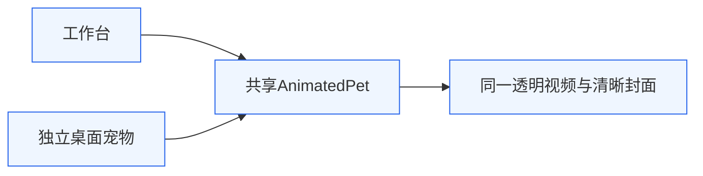
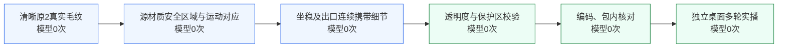

# 0.7.8 桌面宠物毛纹连续性

## 目标与边界

继续减轻翻身回接的毛纹来源切换，保留原兔子、全部实际动作及24fps时序，不用输出模糊、强锐化或轮廓变形。版本沿用架构v3，账户、本机权限、用户工具、窗口和播放器逻辑不变。

两处界面共用视频，但本轮运行验收以独立pet.html窗口为准，不能用工作台截图代替桌面宠物的连续播放。

真实毛纹先在原图材质空间排除眼鼻、围巾和透明轮廓，再随既有动作对应进入白毛内部；坐稳、反向回正及出口采用相同来源。透明度和五官保护区保持原样，素材经过校验编码后进入实际桌面窗口。此链不调用生成模型。

## 修改与原因

上一版仍在出口第一内帧直接切换白毛细节，局部保护环又混用两套纹理，因而首尾相同仍不等于材质连续。本次把源安全区域与细节一同对应到相近坐稳姿态，避免在接点才突然换相。

源B材质安全区域保留透明边缘至少18px距离并设过渡，排除眼鼻、围巾及其邻域；先在源图分离细节，再做对应采样，避免将透明轮廓的结构边缘误当作毛丝。不是增加整头运动场或重绘角色，不做细节增益归一化、去卷积、输出模糊或锐化。

默认 `momo-actions-material.webm`，497帧/24fps/约20.708秒，清晰poster不变。仅尾部43帧RGB材质变化，全部497帧alpha与0.7.7逐字节相同。原2..362共361帧及翻身20..104共85帧原样保留；105..124的动作位置、眼鼻/轮廓、正反播放顺序和时序保留，仅白毛安全内区细节改变。

脚本：`carry-rabbit-material.py`、`preserve-rabbit-source-material.py`及`prepare-rabbit-material.py`。已用新目录复现36张候选PNG，与审查版本逐SHA一致；不覆盖源文件。需要已核验的Vision对应缓存，输入和依赖见脚本帮助。

## 离线验证

- 497帧实际WebM解码、24fps、透明通道；原361帧MD5与原片2..362一致，首尾解码相同。
- 全alpha一致，动作轮廓和时序不变；最小边距左10、右12、上6、下44px，无出画。
- 出口第一步白毛运动补偿细节差由0.002459降至0.000839，约降低66%；保护环由0.001830降至0.000798。后段材质坐标相关性提高；此指标不证明毛丝逐根完全相同。
- 相对旧版，低频修正RMS最大约0.168个8bit码值；相邻均值修正步最大0.0000693，未测出新增广域曝光脉冲。
- 仍有小幅纹理相位/局部对比差；某交接帧约4.2%的细节抵消，不将其描述为全区域恒定清晰或完全恢复原材质。不可通过强锐化追零。
- 162项测试通过，1项真实凭据检查跳过；构建与macOS arm64 ZIP完成，未签名。
- 本机0.7.8包内视频SHA与正式资产一致：0196041f8cd4df3fe17850935c070f9695b854936d2c37372fe28d5c572bd90f。原3个工具内容SHA未变，pet.visible=true、quiet=false。

## 实播证据

本机 `evidence/momo016/desktop-final/` 为同一次CUA调用的86秒真实桌面窗口截图，1806张，逐张保存真实全局时间戳。录前、录后均确认标题“Momo 桌边伙伴”和pet.html，尺寸520×1000，固定视频ROI约(142,631)-(502,963)。不将此前分批试录或后台调用失败的pilot混入正式证据，不用渲染源视频重复播放冒充桌面实录。

实际桌面审查通过本轮改善：四次连续回接约20.827、41.535、62.244、82.952秒，覆盖三个完整循环。选取真实20.360..83.441秒的1285张截图，生成63.082秒三轮实录和同时间轴局部放大版；完整实录85.942秒、1806张。视频逐张PTS对应真实截图时间，不补帧、不复制循环、不变速、不删除内部等待。逐轮接点与前段材质交接联系图未见明显新增爬纹、清晰度呼吸、色光闪变、变形或裁耳。

验收报告为本机 `evidence/momo016/native-review.md`，时间戳回执在 `audit/native-final/encoded-pts-check.json`。截图采样中位间隔41ms，40个间隔超过100ms，最长760ms；接点附近也有95..143ms采样间隙。因此不声称逐帧实时观看、24fps零掉帧或毛纹物理完全一致。原素材仍有轻微相位与局部对比差，可按下述方式回退。

## 回滚

默认资产引用改回 `momo-actions-crisp.webm`，或使用保留的0.7.7应用包；可revert本次提交，不覆盖用户数据库或配置。
