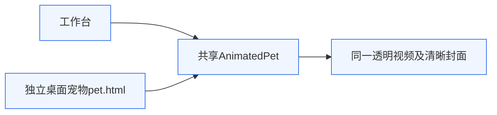
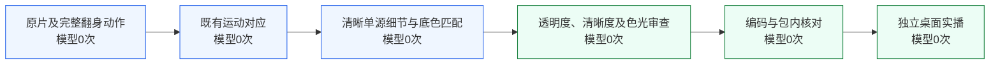

# 0.7.9 清晰转场复验

## 目标与责任边界

用户指出0.7.8仍有放大毛纹差异，以及视频交接时先糊再清晰的问题。本轮沿用架构v3、独立桌面窗口、共享AnimatedPet及24fps透明WebM，只处理素材；账户、权限、观察、工具、窗口/播放器生命周期不改。

两处复用同一播放器和素材；本轮以独立桌面宠物真实运行验收，不以工作台预览代替。

S1保留原片动作，S2复用既有运动路径；S3取消两套高频纹理平均，细节只从一张清晰源图取样，缓慢底色差另作校正。S4同时检查清晰度、材质和轮廓，通过后S5编码进入真实应用包，由S6核对桌面结果。产品播放链不调用生成模型。

## 重新定位与旧验收遗漏

旧桥白毛保护区域以外的眼缘、胡须、围巾仍叠加A/B图像。不同相位的针织与毛丝相互抵消；entry、settle和exit中段围巾高频比同姿态任意单源低约8%–14%。此问题在素材生成处，不是桌面播放器缩放或视频加载引起。

0.7.8“首步毛纹变化减少66%”只量化时间差，没有验证逐帧细节是否被平均；桌面尺寸联系图也不足以证明放大后的清晰度。本轮用放大图、单源对照、光照均值和真实播放共同审查，不把变平滑当清晰。

## 方法与拒绝方案

单源B完整RGB只取样一次，使用其自身alpha反预乘，B覆盖不足才离散选择A。已有位移场和alpha轨迹复用；不增加轮廓运动场。单独计算sigma4的低频色差校正，细毛/针织不再参与A/B高频平均。这是平滑底色差场，最终RGB图像不作模糊，不作锐化、去卷积或高频增益。

原2..362共361帧保留，翻身20..124全部105个动作及自然反向123..112保留；原0.7.8的白毛纹理接种撤销，翻身白毛回到原graded源，只有围巾底色改变。去掉两张并非原动作的坐稳人工混合帧，避免把连续源动作再次插值糊化；总495帧，24fps，20.625秒。封面与首尾仍为清晰原2。原片失焦原1仍不重复引入。

已拒绝：纯B直接接入（围巾首步约6%亮度突变）；仅修改频带计算顺序（改善很小）；眨眼时提前全身换材质（眼下白环及头顶色边）。这些未进入默认资源。

复现工具：prepare-rabbit-clear-bridge.py与prepare-rabbit-clear.py；显式输入已审查素材/运动缓存，输出目录必须不存在，避免覆盖原素材。原入口8张、出口12张，以及围巾调色105张、新调色两桥20张均用独立新目录复现，逐SHA与审查候选相同。其余数据及实播结果见本轮本机evidence/momo017。

## 围巾色光与保护验证

原生成围巾偏暗，校色仅在有限HSV/连通材质mask内作加法RGB偏移。针织孔填为同一材质内区、核心mask恒1、边界向内3px过渡；不逐针织明暗调增益，不改对比，不改白毛和眼鼻。两端offset以既有运动对应中的绿色材质鲁棒中位差拟合，在105帧内缓慢插值，112后固定。

独立105帧检查：alpha和域外RGB精确不变，核心色差spread=0，零新clipping，未选中高亮白毛；放大未见脚部误选、色斑或洗白。匹配围巾亮度中位差入口−0.04374→−0.000124，出口+0.04866→−0.000922。围巾core均亮原片0.38735、生成旧0.33559、校色后0.38265，P10/P90也接近原片。

固定画面ROI仍有约0.0465亮度变化，不能把它当成围巾整体未校色：该ROI包含上沿下巴白毛、胡须和材质边界，不同姿态覆盖不同。共同绿色材质残差均值约−0.00568。仍有源毛纹、虹膜高光和下巴/胡须照明差，不承诺物理光泽或逐根毛丝完全一致。

## 构建与源序列验证

162项测试通过，1项真实凭据检查跳过；macOS arm64构建、打包完成，未签名。本机0.7.9包内视频SHA与正式资产一致：51399b5eac057ba9aeea1320045671368ba708b5807bd97576db22661a7cc66d。

495帧实际解码、24fps、透明通道；361原片帧顺序逐文件一致，105校色动作帧和12自然逆序、入口6/出口10与审查候选顺序逐SHA一致。495/495 PNG alpha与旧轨迹映射精确相同；实际VP9解码alpha最大差1/255、平均差0.01235个8bit码值，495帧alpha>32的轮廓mask与PNG全部相同。首尾文件相同，最小边距左10、右12、上6、下44px。用户原3个工具SHA不变，宠物visible=true、quiet=false。

## 桌面实播

本机evidence/momo017/desktop-final为同一次CUA调用约86秒的真实独立桌面窗口采集，1085张逐张保存before/after与中点时间戳。录前录后均确认“Momo 桌边伙伴”及pet.html，尺寸520×1000，视频ROI(142,631)..(502,963)。实际采集跨度85.98596秒，中位间隔74.3ms、最大282.2ms，125个间隔超过100ms；不能据此承诺24fps截图或零掉帧。四次回接约19.1125、39.7375、60.3625、80.9875秒，覆盖三个完整循环；各轮入口361..368及出口均生成实际截图联系图复核。未见旧叠图软中段、明显新曝光闪变、白眼环、斑点、裁耳或轮廓拉伸；剩余细纹/虹膜及下巴照明差保留。完整实录85.987秒、1085张；选取真实18.69236..81.48174秒的801张截图，生成62.790秒三个完整循环实录及同时间轴局部放大。无补帧、额外复制循环、变速或删除内部等待；编码帧数与截图数一致、PTS严格递增，最大时间戳偏差全录0.500ms/三轮0.508ms，处于1ms视频时间基内，末PTS完整覆盖。

独立验收接受本轮清晰度改善，报告为本机evidence/momo017/native-review.md，时间回执为audit/native-final/encoded-pts-check.json。实际截图不是恒定24fps屏幕录像，不声称逐帧实时观看或零渲染掉帧。不以源码序列或工作台预览代替桌面验收。

## 回滚

默认引用恢复momo-actions-material.webm或使用保留的0.7.8应用包；本次提交可revert，不覆盖用户SQLite、账号或权限设置。
